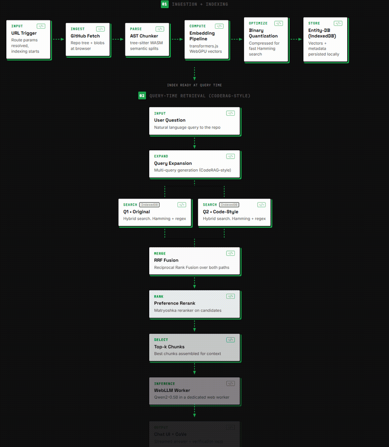
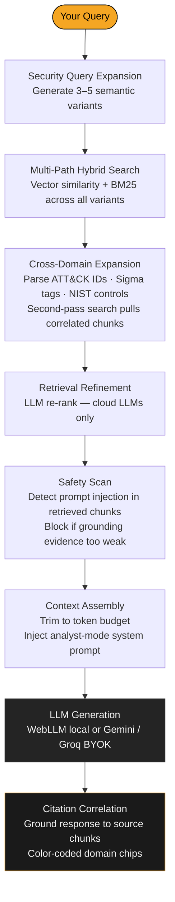
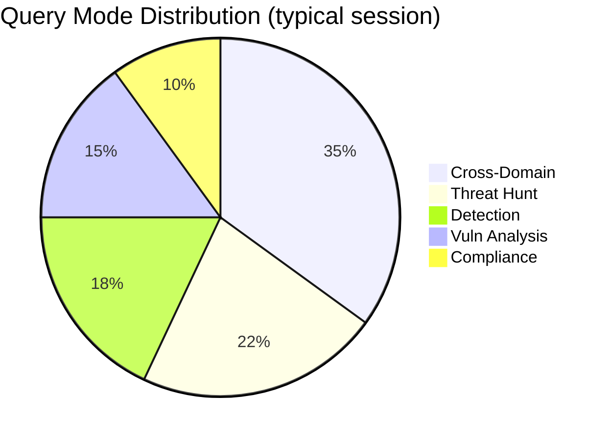
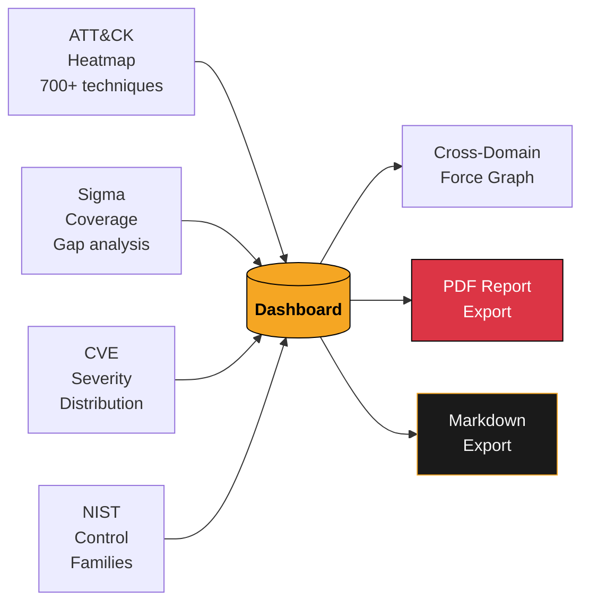
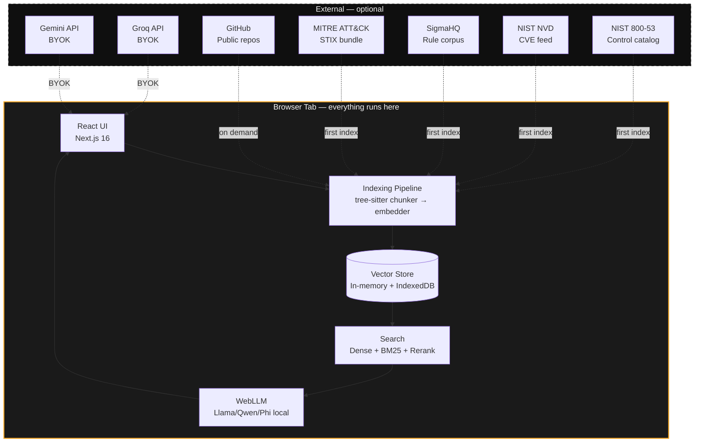

<div align="center">



# ThreatLens

**Ask your security stack anything — entirely in your browser.**

[](https://nextjs.org)
[](https://react.dev)
[](https://www.typescriptlang.org)
[](https://developer.mozilla.org/en-US/docs/Web/API/WebGPU_API)
[](#how-it-works)
[](LICENSE)

Browser-native RAG for MITRE ATT&CK, Sigma rules, CVEs, NIST 800-53, and your own docs.
Cross-domain retrieval. No server. No cloud. Everything runs in your tab.

[Quick Start](#quick-start) · [Sources](#data-sources) · [How It Works](#how-it-works) · [Dashboard](#dashboard--reports) · [Stack](#stack) · [Contributing](#contributing)

</div>

---

## What is ThreatLens?

ThreatLens is a **local-first security intelligence platform**. Pick a data source — MITRE ATT&CK, a Sigma rule corpus, recent CVEs, NIST 800-53 controls, or files you upload — and it indexes everything **directly in your browser** using WebGPU-accelerated embeddings. Then you chat against it.

**No data ever leaves your machine.** No API key required to start (bring your own for cloud LLMs, or run a model locally with WebLLM). Indexes persist in IndexedDB so subsequent loads are instant.

Built for detection engineers, threat hunters, vulnerability analysts, and compliance teams who want to ask natural-language questions across security knowledge bases — without spinning up a server.

---

## Data Sources

| Source | Route | Coverage |
|--------|-------|----------|
| 🟠 **MITRE ATT&CK** | `/threatlens/attack` | 700+ techniques, sub-techniques, tactics, threat groups, software, mitigations — STIX bundle |
| 🟢 **Sigma Rules** | `/threatlens/sigma` | 2000+ community detection rules (SigmaHQ) with ATT&CK tag mapping |
| 🔴 **NVD / CVEs** | `/threatlens/nvd` | Recent CVEs from NIST NVD API — CVSS v3 scores, CWE references, affected products |
| 🔵 **NIST 800-53** | `/threatlens/nist` | All control families across LOW/MODERATE/HIGH baselines, enhancements, supplemental guidance |
| 🟣 **Custom Upload** | `/threatlens/custom` | Your own TXT, MD, JSON, YAML, PDF — pentest reports, runbooks, policies, anything |

> First-time indexing downloads public data directly in your browser (~2–80 MB depending on source). Subsequent loads are served from the local IndexedDB cache in seconds.

---

## What You Can Ask

```
"What ATT&CK techniques are used by APT29?"
"Show me Sigma rules that cover T1059.001 PowerShell execution"
"What critical CVEs affect Apache HTTP Server in the last 90 days?"
"Map NIST AC-2 to the relevant ATT&CK mitigations"
"Which detection rules in the index have no ATT&CK coverage?"
"What does control IA-5 require at the HIGH baseline?"
"Find all techniques in my uploaded threat model that overlap with indexed Sigma rules"
"Generate a security report for this GitHub repository"
```

ThreatLens automatically correlates **ATT&CK IDs ↔ Sigma tags ↔ CVE references ↔ NIST controls** across a single query and grounds every answer in citations back to the source chunks.

---

## How It Works



> Everything from embedding to generation runs **in the browser tab** — zero server requests.

---

## Analyst Modes

ThreatLens detects the right mode from your query automatically, or you can pin one from the input bar:



| Mode | Best for |
|------|----------|
| 🎯 **Threat Hunt** | TTP lookups, adversary profiling, technique enumeration |
| 🔍 **Detection** | Sigma rule coverage, detection gap analysis, rule quality |
| 🐛 **Vuln Analysis** | CVE triage, CVSS scoring, patch prioritization |
| 📋 **Compliance** | NIST control mapping, baseline gaps, audit evidence |
| 🌐 **Cross-Domain** | Questions spanning multiple sources — the default |

---

## Dashboard & Reports

The `/dashboard` gives you a live intelligence overview of everything you've indexed:



### Report Features

Every exported PDF report includes:
- **Risk Level badge** (CRITICAL / HIGH / MODERATE / LOW) on the cover
- **"What This Means"** — plain-English summary, no jargon
- **Priority Action Plan** — numbered by urgency with color-coded badges
- **Per-finding cards** — WHAT IS THIS · WHY IT MATTERS · HOW TO FIX IT
- **Business impact statements** for 15+ vulnerability types (SQL injection, XSS, RCE, etc.)
- Footer with page numbers on every page

---

## Architecture



---

## Quick Start

```bash
git clone https://github.com/OffensiveSage/ThreatLens.git
cd ThreatLens
npm install
npm run dev
```

Open [http://localhost:3000](http://localhost:3000).

1. Click a **source card** on the landing page (start with **ATT&CK** or **NIST** — they index fastest)
2. Wait for the progress bar — data is fetched and embedded locally
3. Ask questions in natural language
4. Click **CONTEXT** in the header to inspect raw retrieved chunks

### Optional: Cloud LLMs (faster, better reasoning)

Open **LLM Settings** (gear icon in the chat header) and paste a [Gemini](https://ai.google.dev) or [Groq](https://console.groq.com) API key. Keys are encrypted via `byok-vault` and never leave your browser.

---

## Stack

| Layer | Technology |
|-------|------------|
| Framework | Next.js 16 · React 19 · TypeScript 5 |
| Embeddings | `@huggingface/transformers` — `all-MiniLM-L6-v2` via **WebGPU** / WASM fallback |
| Local LLM | `@mlc-ai/web-llm` — Llama 3, Qwen, Phi quantized models in-browser |
| Cloud LLM | Gemini API · Groq API — BYOK, keys encrypted via `byok-vault` |
| Search | Hybrid: dense vector similarity + BM25 sparse + reciprocal rank fusion |
| Vector Store | Custom in-memory store + IndexedDB persistence (`entity-db`) |
| Visualizations | Recharts (severity charts) · D3 force graph (cross-domain) |
| Reports | jsPDF + jspdf-autotable · structured PDF export |
| Styling | Pure CSS · CSS variables · **Dark Papercut Layers** design system · no Tailwind |
| Animations | Framer Motion |
| Code parsing | `web-tree-sitter` — AST-aware chunking for 9 languages |

---

## Design System

**Dark Papercut Layers** — charcoal backgrounds, amber accents, hard ink shadows.

```
Background  #0F0F0F  — deep charcoal
Surface     #1A1A1A  — paper card layer
Surface+    #242424  — elevated panel
Text        #F5F5F5  — near-white ink
Accent      #F5A623  — signature amber

Shadows     3px 3px 0px #000000       — sharp layer-1
Hover       5px 5px 0px #F5A623       — amber lift
Radius      max 2px everywhere        — sharp edges
Fonts       Archivo Black (display) · DM Sans (body) · JetBrains Mono (code)
```

---

## Project Structure

```
src/
├── app/
│   ├── page.tsx                        # Landing page — hero + 6 source cards
│   ├── [owner]/[repo]/page.tsx         # GitHub repo chat interface
│   ├── threatlens/[domain]/page.tsx    # Security source chat (ATT&CK · Sigma · NVD · NIST · Custom)
│   ├── dashboard/page.tsx              # Intelligence overview dashboard
│   ├── api/gemini/route.ts             # Gemini BYOK proxy
│   ├── api/groq/route.ts               # Groq BYOK proxy
│   └── globals.css                     # Full design system (~2000 lines)
├── components/
│   ├── SourceCard.tsx                  # Landing source connector card
│   ├── ToastNotification.tsx           # Auto-dismiss toast notification
│   ├── chat/                           # RepoHeader · ChatMessage · ChatInput · QuickActions · ...
│   ├── visualizations/                 # ATTACKHeatmap · SeverityCharts · CrossDomainGraph
│   └── security/                       # ScanReport · SecurityScanModal
└── lib/
    ├── connectors/                     # attack.ts · sigma.ts · nvd.ts · nist.ts · upload.ts
    ├── vectorStore.ts                  # Vector store + IndexedDB cache
    ├── search.ts                       # Multi-path hybrid search
    ├── securityModes.ts                # 5 analyst mode prompts
    ├── reportGenerator.ts              # PDF + Markdown export
    ├── citationUtils.ts                # Source citation extraction
    ├── promptSafety.ts                 # Injection scan + evidence coverage
    └── llm.ts                          # WebLLM · Gemini · Groq unified interface
```

---

## Adding a New Source

Each connector implements a single async function:

```typescript
// src/lib/connectors/yourSource.ts
export async function indexYourSource(
  store: VectorStore,
  progress: (p: ConnectorProgress) => void,
  signal: AbortSignal
): Promise<void> {
  // 1. Fetch or receive data
  // 2. Chunk it (CodeChunk[])
  // 3. store.addChunks(chunks) — embeddings happen automatically
}
```

Then add a route in `DOMAIN_META` in `threatlens/[domain]/page.tsx` and a card on the landing page. That's it.

---

## Acknowledgments

- [MITRE ATT&CK®](https://attack.mitre.org) — adversary tactics and techniques
- [SigmaHQ](https://github.com/SigmaHQ/sigma) — open community detection rules
- [NIST NVD](https://nvd.nist.gov) — National Vulnerability Database API
- [NIST SP 800-53](https://csrc.nist.gov/publications/detail/sp/800-53/rev-5/final) — security and privacy controls
- [GitAsk](https://github.com/FloareDor/gitask) — the browser-native RAG foundation this is forked from

---

## Contributing

PRs and issues always welcome. The connector pattern is designed to be extended — the hardest part of a new source is usually deciding how to chunk the data.

If you find a retrieval quality issue, open an issue with the query and what you expected. Cross-domain correlation is the trickiest part and always has room to improve.

---

## License

MIT
